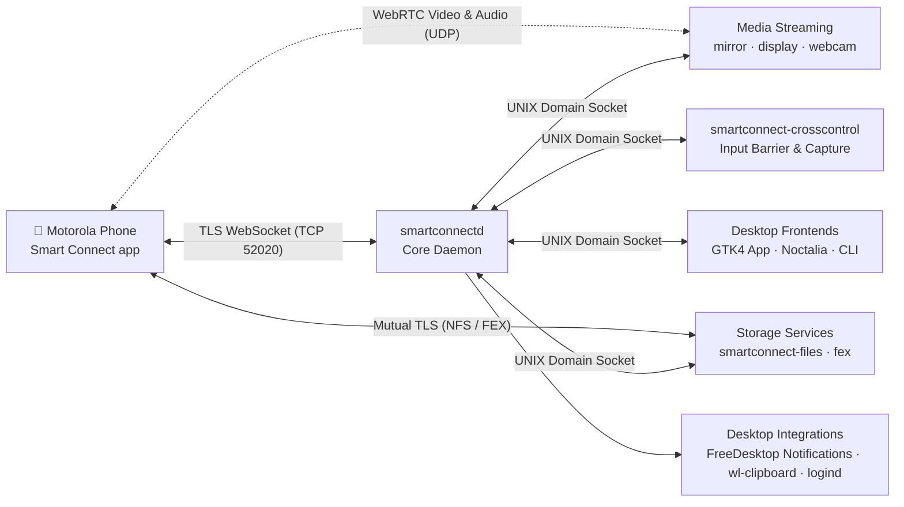

# Architecture & Components

Smart Connect for Linux is architected as a modular suite of specialized micro-programs coordinated by a background daemon (`smartconnectd`).

---

## High-Level Architecture

The Motorola phone treats `smartconnectd` identically to Motorola's official Windows companion software:



---

## Component Directory

| Binary / Component | Source Directory | Primary Responsibility |
|---|---|---|
| **`smartconnectd`** | `src/` | **Central Daemon & CLI**: Runs the TLS WebSocket server, orchestrates pairing and mDNS discovery, handles Bluetooth LE background wakes, manages clipboard and notification bridges, and exposes the local UNIX control socket (`$XDG_RUNTIME_DIR/smartconnectd.sock`). |
| **`smartconnect-mirror`** | `mirror/` | **WebRTC Screen & App Mirror**: Renders full-screen phone mirror and individual streamed Android app windows with low-latency hardware decoding. Houses the headless background stream host for notification actions. |
| **`smartconnect-crosscontrol`** | `crosscontrol/` | **Cross Control Forwarder**: Uses invisible screen edge barriers (via `wlr-layer-shell` pointer constraints or GNOME's `InputCapture` portal) to seamlessly route PC keyboard and mouse input directly to the phone. |
| **`smartconnect-display`** | `display/` | **Second Display Driver**: Turns the phone into an extended or duplicated desktop display. Injects touch input events back into Linux and renders an on-screen keyboard for phone touch typing. |
| **`smartconnect-webcam`** | `webcam/` | **Phone Webcam Bridge**: Captures the phone's front or rear camera stream and feeds it into a virtual `/dev/video*` node (`v4l2loopback`) or directly into PipeWire. |
| **`smartconnect-files`** | `files/` | **Storage Integration**: Mounts `/sdcard` as a local FUSE filesystem (`~/Phone`) and provides a lightweight File Station server to share PC directories with the phone over fingerprint-pinned mTLS. |
| **`smartconnect-fex`** | `fex/` | **File Exchange Client**: Client for the phone's high-speed file transfer service; downloads high-resolution app icons into `~/.cache/smartconnect-linux/app-icons/`. |
| **`smartconnect-gui`** | `gui/` | **Native GTK4 / Libadwaita App**: Modern 2026 dark desktop client with responsive 4-column app launcher, phone layout mockup, command palette (`Ctrl+K`), preferences dialog, and rich system tray telemetry. |
| **Noctalia Plugin** | `noctalia-plugin/` | **Desktop Shell Extension**: Bar indicators, control center quick toggle, and embedded panels for systems using Noctalia Shell. |
| **Reply Window** | `desktop/reply.qml` | **Quick Reply Overlay**: Lightweight Quickshell popup allowing instant text replies to phone notification alerts. |
| **Packaging & Installers** | `packaging/` | Systemd user service unit, desktop entry files, multi-resolution hicolor squircle icons, `install.sh`, and distribution packaging files. |

---

## Inter-Process Communication (IPC)

All frontends (the GTK application, the Noctalia Shell plugin, and custom user scripts) communicate with the daemon via JSON-RPC over a local UNIX domain socket located at:

```
$XDG_RUNTIME_DIR/smartconnectd.sock
```

For full API specifications, message formats, and CLI examples using `socat` or `nc`, refer to the [Control Socket API Reference](control-socket-api.md).
